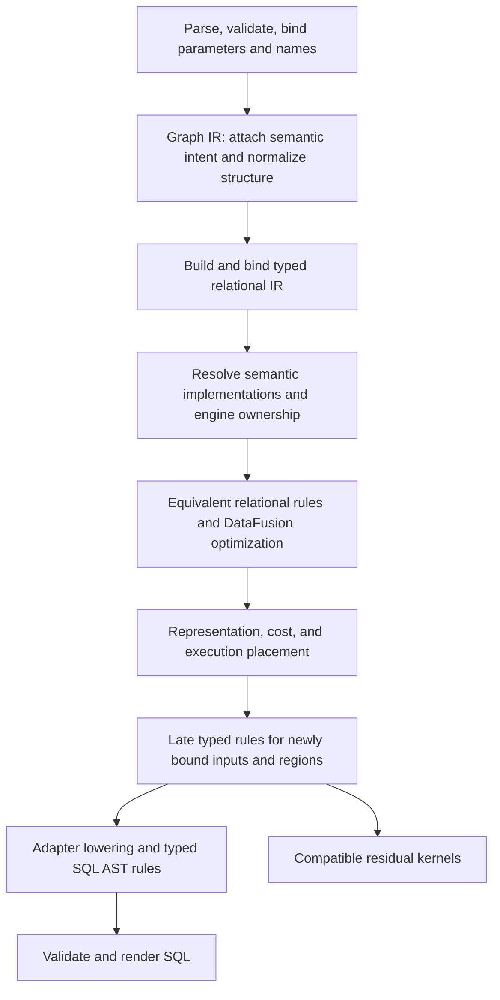

# Applying rules consistently across OrchidDB

Implementation handoff for a new coding agent · 2026-10-18

**Objective:** make semantic selection, optimization, and adapter lowering explicit, consistently scheduled rule stages over the existing IRs. Preserve current behavior by default. Make an opt-in native engine policy possible without scattering mode checks through planners, lowerers, runtime evaluators, and SQL emitters.

**Design priority:** produce simple, fully conformant SQL by supplying optional engine-side compatibility functions where useful. A DuckDB function can implement Orchid's exact conversion behavior directly, avoiding a large expression that reconstructs it from SQL primitives. When an engine cannot accept functions, or their use is disabled, retain conformant SQL expansion. Function availability selects an implementation; it must not select a weaker language contract. Accepting native engine semantics remains a separate, explicit choice.

The answer to “should native engine mode mostly be rules over Graph IR and SQL IR?” is **yes, with typed relational IR as a necessary middle layer**. Graph IR retains language meaning; DataFusion relational IR supplies bound types, schemas, and relational proofs; the SQL AST expresses the selected adapter's implementation. Many important decisions belong in the middle, before SQL serialization and after enough type information exists.

Read [Native engine semantics in OrchidDB](native-engine-semantics.md) for the detailed behavior inventory and executable Cypher-to-SQL tradeoffs. This document defines the implementation architecture and migration work. Proposed names and interfaces below are designs, not existing APIs.

## 1. Instructions for the implementing agent

1. Read the repository [AGENTS.md](../../AGENTS.md), inspect the current working tree, and recheck the source map below. This handoff describes HEAD `22262a0c` plus substantial uncommitted work. Several relevant modules and tests are currently untracked. Preserve that work; do not reset, replace, or broadly reformat it.
2. Implement the first complete milestone in section 10, then extend the migration in independently reviewable steps. A registry that merely names existing functions is useful scaffolding but is not the completed milestone.
3. Keep the shared core engine independent and buildable without DuckDB. Put engine capabilities, SQL spelling, and native execution in adapters. Preserve caller-owned catalogs and sessions.
4. Keep SQL lowering internal. Do not add public compile-only APIs, a combined schema/query request, or an unrelated customer configuration surface to demonstrate this work. Internal policy injection is sufficient for the first milestone.
5. Run relevant checks locally. Do not dispatch GitHub Actions, package releases, remove caches, or rebuild unrelated artifacts.
6. Treat current default results, schemas, errors, evaluation constraints, and explicit ordering as compatibility requirements. Native behavior changes must be explicit, scoped, and tested independently of refactoring.
7. Make optional compatibility functions and their conformant SQL alternatives part of the first milestone. Audit and extend existing function registration before inventing elaborate SQL to reproduce a shared scalar kernel. Engines without installable helpers must retain the SQL implementation for supported domains.

The intended deliverable is working integration plus focused migrations and tests—not a second planner, a new graph model, a textual SQL rewrite system, or an immediate rewrite of every lowering module.

## 2. What already exists

OrchidDB already uses rules, but it has several independently scheduled rewrite paths. Some semantic decisions are embedded in procedural lowering and disappear before a general rule can inspect them. The problem is uneven ownership, visibility, and scheduling, rather than an absence of rewrite infrastructure.

| Area | Current implementation | Architectural implication |
| --- | --- | --- |
| Canonical Graph IR | [plan.rs](../../src/ir/plan.rs), [expr.rs](../../src/ir/expr.rs), [policy.rs](../../src/ir/policy.rs) | Extend the existing graph model. Preserve language policy, scopes, result form, and hidden state. |
| Graph IR / DataFusion bridge | [df.rs](../../src/ir/df.rs), [extensions.rs](../../src/ir/df/extensions.rs), [schema.rs](../../src/ir/df/schema.rs) | Graph operators can be rewritten and round-tripped. This is a structural bridge, separate from executable relational lowering. |
| HEP demonstrations | [hep_optimization.rs](../../tests/hep_optimization.rs) | These tests explicitly say manual rewrites “stand in for a real HEP rule set.” Do not assume there is an active, complete Graph IR rule scheduler. |
| Old transform tree | [transform/mod.rs](../../src/transform/mod.rs), [pipeline.rs](../../src/transform/pipeline.rs), [lib.rs](../../src/lib.rs) | `src/transform` is not wired into the active library and references an older graph representation. Do not enable it wholesale. Port useful ideas selectively. |
| Graph → executable relational plan | [rel/mod.rs](../../src/ir/rel/mod.rs), [expression.rs](../../src/ir/rel/expression.rs), [operators.rs](../../src/ir/rel/operators.rs) | This remains a lowering boundary. Extract decisions from it without pretending construction itself is an optimization. |
| Scalar semantic specialization | [scalar_semantics.rs](../../src/ir/rel/scalar_semantics.rs), [temporal_semantics.rs](../../src/ir/rel/temporal_semantics.rs), [list_comparison.rs](../../src/ir/rel/list_comparison.rs) | Much of the candidate rule logic already exists, including eligibility checks and conservative fallbacks. |
| Relational proofs and rewrites | [constraints/mod.rs](../../src/ir/rel/constraints/mod.rs), [properties.rs](../../src/ir/rel/constraints/properties.rs), [rewrite.rs](../../src/ir/rel/constraints/rewrite.rs), [rules.rs](../../src/ir/rel/rules.rs) | Reuse the fact model, proof records, and DataFusion `OptimizerRule` integration. |
| DataFusion optimizer configuration | [optimizer.rs](../../src/ir/rel/optimizer.rs) | Keep the existing guards around constant folding, recursive projections, and distinct aggregate replacement. |
| Planning and execution scheduling | [dag.rs](../../src/ir/rel/dag.rs), [compiler.rs](../../src/compiler.rs), [rel/mod.rs](../../src/ir/rel/mod.rs) | These paths currently schedule related work differently. Introduce shared stage composition without erasing legitimate differences. |
| Physical representation and cost | [representation.rs](../../src/ir/rel/representation.rs), [layout.rs](../../src/ir/rel/layout.rs), [statistics/optimize.rs](../../src/ir/rel/statistics/optimize.rs) | Separate semantic eligibility from cost-based choice. Keep predicates visible until placement decisions finish. |
| SQL preparation | [unparse.rs](../../src/ir/rel/sql/unparse.rs), [cleanup.rs](../../src/ir/rel/sql/cleanup.rs), [count_filter.rs](../../src/ir/rel/sql/count_filter.rs), [aggregate_scan.rs](../../src/ir/rel/sql/aggregate_scan.rs) | Much “SQL optimization” still operates on typed relational plans. Preserve that advantage. |
| Adapter boundary | [dialect.rs](../../src/ir/rel/sql/dialect.rs), [lowering.rs](../../src/ir/rel/sql/lowering.rs), [functions.rs](../../src/ir/rel/sql/functions.rs) | Existing dialect hooks and typed AST rewrites should own engine syntax and supported implementations. |
| Optional engine-side functions | [shared language kernels](../../src/ir/rel/language_functions.rs), [DuckDB registration](../../src/ir/rel/sql/language_functions.rs), [extension registration](../../extension/src/orchid_extension.cpp), [language function tests](../../tests/language_functions.rs) | There is already shared-kernel and registration infrastructure. Extend it with typed compatibility functions; audit embedded and extension hosts separately. The proposed typed float helper below is not already provided by this registry. |
| Residual execution | [runtime.rs](../../src/ir/rel/runtime.rs), [runtime/optimize.rs](../../src/ir/rel/runtime/optimize.rs), [runtime/host.rs](../../src/ir/rel/runtime/host.rs) | Host execution must obey the same selected semantic contract. Keep runtime kernels as scalar metadata plus Arrow inputs, not executable Graph IR subtrees. |

### Specific limitations to address

- **Semantic expansion happens early.** `cypher_convert.tofloat` can become trimming, replacement, regex, casts, and finite checks inside scalar lowering. Later rules see that implementation rather than the conversion operation and its contract.
- **Rule invocation is mixed into construction.** Existence simplification, cardinality specialization, singleton collection handling, aggregate construction, and scalar fast paths have local call sites and local precedence.
- **Scheduling is distributed.** DAG preparation, direct execution, compiler preparation, and SQL unparsing each perform some combination of constraints, simplification, representation selection, and adapter preparation. Some repetition is intentional because new facts become available; some is difficult to audit.
- **Effect analysis is fragmented.** There are separate notions of `harmless`, `pure`, `total`, `repeatable`, and stable inputs. These predicates answer different questions and cannot safely be replaced by one optimistic boolean.
- **Fast exits need shared contracts.** `unparse_plan_inner` can return through `compact_unwind::emit` before the ordinary SQL preparation sequence. A new policy or required validation must cover that route too.
- **Graph expressions are not ordinary DataFusion expressions.** Graph extension nodes currently return an empty `expressions()` list. A DataFusion expression visitor will not automatically traverse the `IrExpr` fields inside them.
- **Compatibility functions are underused as an implementation option.** The current optional language registry covers keys, selected text/integer operations, and SPARQL support, but the typed string-to-float path still reconstructs parsing behavior in SQL. Treat a shared-kernel function as a first-class candidate before expanding that operation.

Procedural code is still appropriate for binding, validating, constructing operators, encoding values, and emitting syntax. The refactor should extract competing implementations and rewrites, not turn every helper into a rule object.

## 3. Define three different kinds of rules

| Kind | Obligation | Example |
| --- | --- | --- |
| Semantic selection | Choose and record the requested meaning once; never silently switch it later. | Select Orchid-compatible string-to-float or a particular engine's string-to-double behavior. |
| Equivalent rewrite | Preserve the already selected meaning, including observable errors, cardinality, and evaluation requirements. | Remove redundant `DISTINCT` using a valid uniqueness proof. |
| Implementation lowering | Implement the selected meaning on a capable target, preserving the declared input/output contract. | Select a conformant registered conversion function or conformant SQL expansion; separately, emit DuckDB `TRY_CAST(x AS DOUBLE)` for a native-policy conversion. |

“Native” is not blanket permission for every optimizer rule to relax semantics. For example, a native string conversion policy does not change graph identity, collection null filtering, explicit order, integer rounding, or grouping equality.

Use a versioned semantic profile with individual operation policies. Existing `RelBackendOptions::native_values` means Orchid typed values and kernels; `language_functions` selects a lowering capability. Neither should be repurposed as a native semantics switch.

The default profile describes the behavior Orchid currently guarantees. Do not equate it with every behavior of every historical or future Cypher implementation.

### Separate conformance from function availability

“Executes inside DuckDB” and “uses DuckDB semantics” are different properties. A compatibility UDF executes inside DuckDB while preserving the selected language contract, including its parsing restrictions. Its use needs no relaxed conformance mode.

| Selected semantics | Available implementation | Lowering decision |
| --- | --- | --- |
| Full language conformance | A matching typed compatibility function is available and enabled | Emit the compact function call; prefer this for operations otherwise requiring elaborate emulation. |
| Full language conformance | Helpers unavailable, disabled, or not installable | Emit the conformant SQL expansion for the supported input domain. Keep all required guards. |
| Full language conformance | A simple built-in already implements exactly the required behavior | Use that built-in directly; a helper is unnecessary. |
| Explicit native semantics | The owning engine supports the requested native operation | Emit that engine operation, with the documented semantic differences. |

These are capability-based implementation choices, not different levels of conformance. Fully conformant means conformant to the selected, versioned language contract; test that contract rather than assuming the current implementation has no gaps. If neither the helper nor a sound SQL implementation supports an input domain, use a same-contract residual kernel where allowed, or report unsupported SQL-only execution. Never substitute a native cast merely because a compatibility function is missing.

### Optional function support is an adapter capability

Extend the existing optional registration path rather than requiring the DuckDB extension for every deployment. Embedded DuckDB and the loadable extension have different registration surfaces; both should expose the same operation contract when supported. Other adapters can provide equivalent functions, but function installation must not be required for portability.

Advertise capabilities per operation, signature, contract version, null/error behavior, and actual execution session/catalog. “Dialect is DuckDB” or “language functions enabled” alone does not prove a particular helper is registered. Respect explicit opt-out even if an earlier query installed the helper. Capability checks and plan caches must account for missing, mismatched, or changed registrations, including pooled and caller-owned connections. Prepare registration through the existing adapter/session lifecycle; keep rule matching free of catalog mutation.

Prefer typed, batch-oriented functions backed by the shared semantic kernel. For a string-to-double helper, transport a nullable string and return a nullable double; do not serialize whole graph rows or invoke the query compiler per value. Reuse the conversion implementation across host evaluation, compatible constant folding, and engine callbacks. Keep engine bindings and FFI in the adapter, with correct null handling, error propagation, and stability declarations. Do not copy a generic wrapper's volatility or null behavior without checking this operation.

An SQL macro can reduce emitted text, but it may expand back into the same expensive plan. Measure execution and optimizer effects as well as SQL size. Prefer the helper for complex semantic emulation, while retaining simple equivalent SQL when it is cheaper or exposes useful optimization. Do not assume a function call is faster solely because it is shorter.

## 4. Target pipeline and stage ownership



This diagram defines responsibilities, not a license to reorder the current passes in one patch. Bindings and placement can expose more opportunities, so the actual program has explicit, bounded revisits. A later stage may resolve an implementation that earlier stages could only annotate.

### A. Frontend validation and Graph IR normalization

Keep parsing, arity checks, name resolution, lexical scope, and language validation in the frontend. Do not rely on an optimization firing to reject invalid source. Parameter binding must receive the semantic context before any policy-sensitive folding.

Graph rules should operate while language operations are recognizable. Suitable work includes redundant structural operators, safe collection/cardinality simplifications, demand propagation, and semantic annotations. Graph rules must not assume that a placeholder graph schema is a catalog-proven scalar type.

Prefer one canonical Graph IR traversal facility and rules over the existing `GraphPlan`. Reuse the active `ir::df` bridge when a DataFusion plan rule benefits from it, rather than making a second graph representation authoritative. If the bridge is used for scheduling, provide explicit access to embedded `IrExpr` fields; its existing `expressions()` implementation is insufficient.

### B. Typed relational construction and semantic implementation

Build executable relational operators using the current lowering code. Preserve unresolved semantic operations until types and engine ownership justify choosing their implementation.

A semantic descriptor needs the operation identity, selected policy, argument/result type requirements, null/error behavior, evaluation restrictions, and any engine ownership. The first migration can add this for conversions rather than replacing every string-named call at once.

The descriptor need not survive forever. Once policy and input types are known, select among equivalent implementations: a simple built-in, a registered compatibility function, or conformant SQL expansion. Keep the operation recognizable until the target's function capabilities are known; expanding guards first would obscure the opportunity to emit a helper call. Retain an engine-owned conversion as an identifiable logical operation until its adapter lowers it. After selection, subsequent rules preserve that contract.

Typed facts must come from binding and catalog evidence. The bridge's [schema inference](../../src/ir/df/schema.rs) handles some real types but also uses placeholders for unresolved graph values. It is not a universal type oracle for semantic conversion decisions.

### C. Equivalent optimization and physical choice

Use DataFusion's existing optimizer for relational expressions and plans. Register Orchid rules in well-defined stages around it. Keep the guarded optimizer wrappers in `optimizer.rs`; replacing the entire rule list would discard existing correctness protections.

Select representations and layouts only among alternatives that satisfy the semantic contract. Statistics can choose which valid alternative is cheaper; they cannot prove equality, totality, uniqueness, complete value domains, or absence of nulls.

Run eligible optimization before opaque regions hide the plan. Any rewrite after placement must preserve that placement's constraints or trigger explicit reanalysis. Do not let a cost decision silently choose which engine's semantics the query receives.

### D. Adapter preparation and SQL AST lowering

Keep typed relational rules before unparsing when they depend on types, nullability, function identity, keys, or effects. Use SQL AST rules for adapter syntax, names, literal encodings, and dialect-specific query forms. Do not reconstruct lost semantic intent from regex-shaped SQL or function-name strings.

Reuse `DialectAdapter` and `RelationLowering`. The latter already distinguishes SQL statements, relational rewrites, and dependent sources, with schema and ownership checks. Preserve these checks in the common stage runner.

Select compatibility functions using the adapter's verified function capabilities. If helpers are unavailable, select the conformant SQL alternative before final emission. Preserve logical operation identity, argument/result types, and function contract metadata through this decision; a registered name alone is not proof of equivalent behavior.

Register narrow emitters such as `compact_unwind` as adapter implementation alternatives with explicit eligibility and required preconditions. They may retain their fast output path, but must not bypass semantic resolution, capability validation, or final output-schema checks.

### E. Residual execution

An unsupported SQL implementation may fall back only to a kernel implementing the **same** contract. A strict Orchid evaluator is not a valid fallback for an engine-owned conversion merely because it has the same result type.

For the first native operation, require the owning engine or report a specific unsupported placement. Add a portable fallback only with an established equivalence proof. Do not make an optional engine a dependency of the default core to manufacture a fallback.

## 5. A common rule contract, not a new universal IR

Share registration, context, outcomes, diagnostics, and scheduling conventions. Keep graph, relational expression, relational plan, and adapter rules typed to their own representations. Existing DataFusion `OptimizerRule` implementations should participate through adapters, not be rewritten into a parallel optimizer.

An illustrative interface shape:

```text
RuleDescriptor {
  id, version, stage, kind,
  traversal, required_facts, invalidated_facts
}

RuleContext {
  language_contract, semantic_profile,
  target_capabilities, compatibility_function_catalog, engine_ownership,
  catalog_snapshot, analysis_access,
  rewrite_budget, diagnostic_sink
}

RuleResult<T> =
  Unchanged
  | Blocked { reason, missing_facts }
  | Changed { value: T, evidence, invalidation }
  | Error { diagnostic }
```

These are responsibilities, not a mandated Rust ABI. Use existing error and proof types where practical. Distinguish a pattern mismatch from a candidate lacking facts, and both from a malformed program or failed invariant. Do not turn arbitrary errors into “try the next rule.”

### Rule scheduling

- Define explicit stages and stable rule order. A rule declares whether it runs once, in a bottom-up pass, or in a bounded fixed-point group.
- Restrict fixed points to compatible groups with a canonical direction. For example, do not place “expand semantic call” and “recognize expanded semantic call” in the same group.
- Use an explicit changed result and structural identity where needed. Do not use formatted debug output as the change detector, as the inactive transform pipeline does.
- Make budgets per query and stage. An optional optimization may stop at a valid equivalent plan when its budget is exhausted. Required semantic resolution or lowering must either finish or return a clear error; it cannot emit unresolved operations.
- Recompute invalidated analyses before another rule uses them. Avoid repeatedly rebuilding whole-plan facts for every expression where a revisioned analysis cache is sufficient.
- Keep mandatory stages active when optional optimization or diagnostic constant folding is disabled. “Optimizer off” must not select a different language or skip binding and validation.

Do not introduce an e-graph, a new rule DSL, or a global cost search as a prerequisite. The first implementation needs deterministic staged scheduling over infrastructure that already works.

### Traversal and identity

The traversal layer must cover graph operator fields, projections, filters, aggregate inputs, sort expressions, nested plans, dependent/correlated regions, and repeat/control bodies. Expression traversal must respect binders in list transforms, filters, reductions, and quantifiers; lexical substitution must not capture a shadowed variable.

Do not share a scope-insensitive cache of “this expression is safe.” Correlation and evaluation scope are part of the analysis key. Track rewritten node identities or plan revisions and invalidate island-safety and related memoized analysis after mutation.

If semantic metadata is added to the IR, carry it through cloning, serialization, bridge round trips, nested plans, and equality/hash logic. The current graph extension hashing and ordering are deliberately coarse; do not assume they provide a complete semantic fingerprint. Preserve policy, hidden columns, schemas, ordering requirements, and result form when rebuilding nodes.

### Context and cache identity

Pass semantic context explicitly through compilation and preparation, including nested work. Do not implement production policy using a global or thread-local switch. The [diagnostic folding control](../../src/ir/diagnostics/folding.rs) is a diagnostic mechanism, not a template for policy propagation across async tasks.

A cached plan must be tied to the semantic profile/version, relevant adapter capabilities, catalog/schema revision, and semantic session settings. Include compatibility-function enablement and contract/registration identity so a helper-dependent plan cannot be reused on a session without that helper. Include engine identity/version when the selected operation depends on them. Preserve existing parameter-sensitive behavior; do not assume bound parameter values can be removed from a cache key just because rule execution is now centralized.

In federated plans, distinguish the requested semantic owner from the engine chosen for a particular source. If the request has not established which engine owns an operation, keep it unresolved until ownership is determined. Never derive its meaning from whichever engine happens to win a cost comparison.

## 6. Reuse and strengthen analysis rather than duplicating guards

Start from the existing [relational properties](../../src/ir/rel/constraints/properties.rs) and [rewrite proofs](../../src/ir/rel/constraints/rewrite.rs). Preserve their distinction between grouping uniqueness with nulls equal and equality keys suitable for joins. Nullable uniqueness alone does not establish every distinct-removal or join-elimination precondition.

Expose facts to rules with provenance and a validity scope:

| Fact family | Needed distinctions |
| --- | --- |
| Types and nullability | Known SQL type versus dynamic graph value; null versus missing; a bound type versus a placeholder. |
| Cardinality and keys | Global aggregate versus grouped aggregate; zero/one/many rows; unique keys, equality keys, dependencies, complete sources. |
| Effects | Can throw; volatility; external effects; repeatability within an evaluation scope; safe to duplicate; safe to discard; short-circuit requirements. |
| Ordering | Explicit user order, observable internal ordinal, unspecified order, and order required only by a particular implementation. |
| Value domains | Complete immutable domain versus samples or estimated min/max; integer bounds; representable temporal domains. |
| Placement | Selected semantic owner; available/enabled compatibility functions and their contracts; SQL and kernel capabilities; transport and result codec support. |

An immutable function can still throw. A repeatable expression may still be unsafe to duplicate if evaluation count is observable. A nullable argument does not justify removing its entire input row. Unknown facts remain unknown and block transformations that require proof.

Migrate existing analyses incrementally. For example, `constraints::harmless`, `runtime::optimize::Contract`, scalar input stability, list comparison repeatability, and collection purity have different scopes. First give their facts a common vocabulary and conservative adapters; consolidate their implementations only after tests establish the same meaning.

Proof records should identify the rule, decisive facts, and their origin. Do not store full row data, credentials, or parameter values in routine traces.

## 7. Representative migrations and actual SQL consequences

### 7.1 String-to-float: select semantics before expanding guards

Current entry points are [expression.rs](../../src/ir/rel/expression.rs) and [scalar_semantics.rs](../../src/ir/rel/scalar_semantics.rs). Extract the conversion decision without changing its initial behavior.

```cypher
MATCH (p:Person)
RETURN toFloat(p.raw_amount) AS amount
```

Assume `raw_amount` is a bound SQL string column. The current compatible lowering has this approximate shape:

```sql
WITH tokens AS (
  SELECT replace(trim(raw_amount), '_', '') AS token FROM person
), parsed AS (
  SELECT token, TRY_CAST(token AS DOUBLE) AS value FROM tokens
)
SELECT CASE
         WHEN regexp_matches(token,
           '^[+-]?([0-9]+(\.[0-9]*)?|\.[0-9]+)([eE][+-]?[0-9]+)?$')
          AND isfinite(value)
         THEN value ELSE NULL::DOUBLE
       END AS amount
FROM parsed;
```

This is explanatory SQL, not the exact emitter output: ordinary `trim` abbreviates Orchid's Unicode whitespace treatment, and `isfinite` abbreviates the emitted finite checks. `regexp_matches` is valid DuckDB SQL. The extra work implements a selected conversion contract; it is not simply an incorrect function spelling.

**Preferred conformant implementation when the helper is available:** expose the shared string-conversion kernel as a typed function and emit:

```sql
SELECT __orchiddb_cypher_to_float_v1(raw_amount) AS amount
FROM person;
```

The function name is illustrative and proposed, not an existing installed API. Its nullable `VARCHAR` → nullable `DOUBLE` contract must implement the selected Cypher conversion rules directly, including Unicode trimming, underscore treatment, invalid strings, and nonfinite string results. The earlier guarded SQL remains the conformant alternative when functions cannot be installed or are disabled; verify it against the same contract. Both paths must agree on results, types, nulls, and required errors. Neither requires native semantics mode.

Under an explicit DuckDB-native string conversion policy, the implementation becomes:

```sql
SELECT TRY_CAST(raw_amount AS DOUBLE) AS amount
FROM person;
```

Use `TRY_CAST`, not plain `CAST`, if the selected policy promises null on failed string conversion. The changed contract includes accepted numeric grammar and nonfinite results; it does not automatically change numeric-input conversion or every other `toFloat` input type.

Proposed rule flow:

```text
Graph intent:  ConvertFloat(raw_amount, selected string-conversion policy)
Typed input:  nullable string, resolved source and semantic owner

Compatible implementations, selected by capabilities:
  convert_float.compatible_function -> registered shared-kernel call
  convert_float.compatible_sql      -> guarded conformant SQL expression
  convert_float.compatible_host     -> same-contract residual kernel, if needed

DuckDB-native implementation:
  convert_float.engine_string -> engine-owned logical conversion
  duckdb.lower_try_double     -> SQL AST TRY_CAST(... AS DOUBLE)
```

Never implement native mode by matching and deleting a regex/finite-check subtree. That would depend on incidental SQL shape and could remove a guard authored for another purpose.

**Constant folding is part of this migration.** For the original query:

```cypher
WITH 'foo' AS foo_string, '' AS empty_string
RETURN toFloat(foo_string) AS foo, toFloat(empty_string) AS empty
```

Both contracts can produce null for these values. Under a proven compatible evaluator, folding to typed nulls is legitimate:

```sql
SELECT NULL::DOUBLE AS foo, NULL::DOUBLE AS empty;
```

That agreement does not authorize folding every engine-native cast with Orchid's or DataFusion's parser. A string such as `'NaN'` distinguishes finite-only conversion from DuckDB-native conversion. Literal, parameter, and column paths must all retain the selected meaning.

The existing [LogicalFunction](../../src/ir/functions/logical.rs) abstraction is useful for logical identity and SQL specialization, but its executable native function assumes an evaluator for the same meaning. A conformant helper backed by the shared kernel can legitimately use that same evaluator for folding once type/effect preconditions hold. Do not wrap an engine-native conversion around a convenient DataFusion `TryCast` and allow generic simplification to fold it without proving equivalence. The first implementation should leave unproven engine-owned literals for the owning engine to fold. Do not mislabel an immutable operation as volatile solely to defeat an optimizer; represent its evaluation ownership or fold eligibility explicitly.

### 7.2 Aggregation: retain the contract around native computation

The current aggregation path already delegates much computation to native aggregates. The architectural opportunity is to make null, empty-input, ordering, distinctness, and accumulator decisions explicit. See [aggregates.rs](../../src/ir/rel/aggregates.rs) and the [aggregation study](native-engine-semantics.md#2-aggregation-native-computation-already-exists).

Compatibility helpers can also keep conformant aggregation inside the engine. The existing Cypher key function is a useful precedent: supply the missing equality/key semantics while letting the engine perform grouping or `COUNT(DISTINCT ...)`. Prefer focused helpers around native aggregates where that preserves the complete contract; consider a custom aggregate only when its state/accumulation semantics require one. Retain the conformant SQL alternative for engines without the helper. Installing functions must not implicitly relax null filtering, order, accumulator behavior, or graph equality.

For a homogeneous integer input:

```cypher
MATCH (p:Person)
RETURN collect(p.age) AS ages, count(*) AS rows
```

A compatible native aggregate shape is:

```sql
SELECT coalesce(
         list(age) FILTER (WHERE age IS NOT NULL),
         []::BIGINT[]
       ) AS ages,
       count(*) AS rows
FROM person;
```

The example assumes no order requirement; where an ordinal must be preserved, the compatible form includes an aggregate-local `ORDER BY`. The actual graph-value path can additionally need semantic keys and codecs.

An explicitly broader engine aggregate contract could allow:

```sql
SELECT list(age) AS ages, count(*) AS rows
FROM person;
```

This changes null inclusion and empty-input results. A narrower native-order policy could remove only synthetic ordering while retaining null filtering and the empty-list wrapper. These are separate choices, not one `native_aggregates` boolean.

Represent aggregate requirements before decomposition: operation, argument, distinct/equality semantics, filter, null policy, empty-result policy, required order, accumulator/result types, and output codec. Reuse current aggregate kinds such as `CollectNonNull`, `SumOrZero`, and `AvgOrNull` rather than discarding their distinctions.

Rules must preserve these invariants:

- Keep collection null filtering inside its aggregate. Moving `age IS NOT NULL` to the input `WHERE` would also change `count(*)` and could remove groups.
- Preserve one row for an ungrouped aggregate over empty input, and zero rows for grouped aggregation when no groups exist.
- Remove only order that the selected contract leaves unobservable. Preserve explicit user order and order consumed by a later operation.
- Use native `DISTINCT` only when the typed domain and selected equality contract justify it. Numeric and structured graph equality can require semantic keys.
- Preserve independent arguments and evaluation scopes for multiple aggregates. Shared distinct/order helpers are not universally interchangeable.
- Keep output type/codec agreement when native accumulation changes width or precision.

Migrate `size(collect(x))` specialization from [frontend aggregate lowering](../../src/language/cypher/planner/lowering/project/aggregate.rs) into a named semantic rewrite only after preserving frontend validation and the aggregate boundary. For a scalar, total input under the current null-eliding collection contract, the relational result can use `count(x)`; dropping `DISTINCT` from `size(collect(DISTINCT x))` would be wrong. Do not apply the rule to unrelated list-valued expressions merely because their SQL names look similar.

### 7.3 Relational and SQL preparation rules: make existing successes reusable

Good early candidates already have conservative conditions and focused tests:

| Rule family | Existing code | Required preservation |
| --- | --- | --- |
| Remove redundant distinct / existence work | [rules.rs](../../src/ir/rel/rules.rs), [constraints/rewrite.rs](../../src/ir/rel/constraints/rewrite.rs) | Key/null proof and observation of multiplicity; no name-based inference. |
| Eliminate trivial naming projections | [cleanup.rs](../../src/ir/rel/sql/cleanup.rs), [aggregate_scan.rs](../../src/ir/rel/sql/aggregate_scan.rs) | No duplicated computations, discarded errors, broken qualifier scope, or changed scan filters/fetch. |
| Convert conditional count to aggregate filter | [count_filter.rs](../../src/ir/rel/sql/count_filter.rs) | Concrete built-in function identity and its existing exclusions for distinct/filter/order/null treatment. |
| Literal-case simplification | [literal_case.rs](../../src/ir/rel/sql/literal_case.rs) | Bound types, error behavior, and evaluation/folding policy. |
| Native scalar collection forms | [primitive_list_comprehension.rs](../../src/ir/rel/primitive_list_comprehension.rs), [collection_evaluation.rs](../../src/ir/rel/collection_evaluation.rs) | Binder scope, totality, null semantics, and evaluation multiplicity. |

Move these behind named stages and common outcomes while retaining their existing proofs. Prefer changes that reduce conditional dispatch at old call sites. A central registry plus every old independent invocation would create double execution and another source of precedence bugs.

## 8. Entry points that must share the contract

One shared stage builder does not mean every path must run an identical sequence. It means required stages and their preconditions are explicit, and differences are intentional and tested.

| Path | Current scheduling concerns | Required integration |
| --- | --- | --- |
| Internal compiler preparation | `compiler.rs` has its own constraint preparation and scan validation. | Carry policy and stage identity; do not execute arbitrary sources to obtain compile-time facts. |
| Managed engine execution | [engine.rs](../../src/engine.rs) routes hybrid reads, SQL-only reads, mapped queries, and mutations differently. SQL-only reads call lowering and SQL preparation directly. | Carry the same semantic context through every route; do not equate `ReadMode::SqlOnly` with a native semantics profile. Preserve mutation and transaction boundaries. |
| DAG preparation | `dag::prepare_with_extensions` branches on optimization and region sessions, binds seeds, reruns constraints, selects representations, and partitions work. | Preserve analyzer/optimizer differences and mandatory normalization with optimization disabled. Use shared stage components at the correct points. |
| Direct lowered execution | `rel::execute_lowered_inner` has its own native relation, constraint, representation, and statistics schedule. | Select the same semantics and effect restrictions as DAG execution. Keep host-specific capability differences explicit. |
| Host and mapped execution | Host compilation, mapped sources, custom adapters, and dependent inputs expose different bindings. | Propagate context into nested plans; late rules see actual bound facts and the correct owner. |
| SQL preparation and emission | `unparse.rs` schedules several typed passes and a compact fast path. | Shared required preparation and validation, including all terminal emitters; adapter-specific ordering remains explicit. |
| Residual kernels | Runtime optimization has its own contracts. | Same semantic profile and valid fallback checks; no silent policy change at a region boundary. |

Before moving a pass, write down what facts become available immediately before its current invocation. Repeated constraint analysis after seed binding, for example, can be necessary. Replacing both calls with one early global pass could regress valid optimizations or correctness.

## 9. Diagnostics and rule observability

Extend existing plan diagnostics rather than adding a separate log stream. [DagStats](../../src/ir/rel/dag.rs) already carries optimizer decisions, constraint proofs, layout and representation selections, and the logical plan. Preserve trace information when forwarding results into [ExecStats](../../src/ir/exec.rs), and account for SQL-only routes that construct execution statistics separately.

A useful opt-in trace record contains:

```text
stage, rule_id, rule_version, outcome,
plan_revision/node_identity,
selected_semantic_contract,
decisive_evidence_or_blocking_reason,
owning_adapter_if_relevant
```

Normal execution should not serialize every before/after plan or format every failed pattern match. Detailed snapshots are opt-in. Capture blocked reasons only for matched candidates where they help diagnose a missed optimization, and cap diagnostic volume.

For the float example, diagnostics should distinguish “conformant helper selected,” “helper unavailable or disabled; conformant SQL selected,” “native string conversion explicitly selected,” and “native conversion requires owning engine.” Report the contract and implementation separately, including why a helper was unavailable. A missing helper is not a reason to relax semantics.

Stable rule IDs let tests assert that a transformation occurred without pinning every generated alias or SQL byte. Include profile and ownership in diagnostic output so identical-looking SQL is not mistaken for evidence that semantics were preserved across all execution routes.

## 10. Migration sequence and first complete milestone

### Phase 0 — Capture the live pipeline

Record active entry points, existing pass order, required facts, terminal fast paths, and current fallback behavior. Add a compact inventory beside the implementation or update this document as discoveries warrant. Run a small baseline set before code changes and record pre-existing failures separately.

Do not use the inactive `src/transform` tree as the migration destination. A reasonable destination is a new internal module beneath `src/ir/` for shared stage contracts and graph traversal, with relational and SQL rule implementations remaining near their current domain modules. Choose names after inspecting current module boundaries.

**Exit condition:** the implementing agent can trace a query from frontend preparation through typed lowering to SQL or residual execution, including the fast paths and disabled-optimization branches.

### Phase 1 — Shared stage contracts around the active infrastructure

Introduce rule descriptors, outcomes, query context, bounded scheduling, and diagnostics. Adapt existing DataFusion/constraint rule reporting rather than duplicating it. Initially preserve the current order of operations and explicit revisits.

Connect stage composition to DAG preparation, direct execution, and SQL preparation. Thread semantic context through managed engine, compiler, and host preparation as needed. Leave semantic defaults unchanged.

**Exit condition:** relevant routes expose the same required contract stages; optional tracing has bounded overhead; disabling optional optimization cannot bypass required semantic work.

### Phase 2 — A real Graph IR rule and safe traversal

Add scoped Graph IR traversal and move a small, clearly equivalent structural rewrite into it—for example, eliminating a filter whose predicate is the literal boolean `true`. Test nested operators and bridge round trips as well as a root-level case.

Preserve graph policy, hidden fields, schemas, and result form. Do not run the general executable DataFusion optimizer over structural graph extensions and assume it understands every embedded expression.

**Exit condition:** the production pipeline actually invokes the rule; the HEP demonstration is supplemented by tests of registered execution, scope handling, and stable termination.

### Phase 3 — Conformant function/SQL alternatives and a native vertical slice

Extract string-to-float implementation selection from procedural scalar lowering. Make the existing compatible lowering a named implementation rule with the same guards and fallback boundaries. Add the minimal semantic descriptor and explicit folding/ownership treatment needed for that operation.

Implement a typed, optional DuckDB compatibility function backed by the shared conversion kernel. Integrate its capability advertisement and registration into the supported embedded and extension paths without adding an engine dependency to the shared core. Select this helper for the conformant conversion when available, and the guarded conformant SQL implementation when unavailable or disabled. Exercise an adapter/session that explicitly cannot install functions; it must still receive the SQL alternative for this supported string domain. Do not defer this work until after native mode: compact SQL with full conformance is a primary goal.

Add an internally selectable, versioned DuckDB-native string-to-float policy. Lower it through the adapter to `TRY_CAST(... AS DOUBLE)`. Keep the default profile unchanged. If the chosen execution route cannot honor the engine-owned operation, report that explicitly. Do not expose an unfinished broad “non-strict” mode.

**Exit condition:** literal, parameter, and mapped string-column cases choose the intended contract. Conformant helper and helper-free SQL agree with the shared reference semantics, including helpers explicitly disabled. Native nonfinite behavior survives folding and placement; unsupported host execution cannot silently run the compatible evaluator. Helper availability changes implementation only, and no helper-dependent plan leaks into a session without the required capability.

### Phase 4 — Demonstrate relational and adapter consistency

Migrate an existing proof-backed relational rule and an adapter preparation rule, such as redundant-distinct elimination and conditional-count normalization. Preserve their current eligibility restrictions. Remove superseded local invocation paths when their replacement is live.

Ensure the compact SQL emitter and ordinary emitter obey the same required preparation contract. Verify nested and dependent regions receive context and analysis invalidation.

**Exit condition:** a Graph IR rule, a semantic scalar implementation, a relational proof rule, and an adapter preparation rule all run through the common conventions in production. The change demonstrably reduces ad hoc dispatch rather than adding an unused framework.

**The first complete milestone is phases 0–4.** It includes a conformant float helper, its conformant SQL alternative, and the separately opt-in native float slice. Deliver small reviewable changes with default behavior preserved. Do not call the overall migration complete merely because its infrastructure compiles.

### Phase 5 — Extend by operation family

Next migrate aggregate contracts and `size(collect(...))`, then collection evaluation, comparison, temporal, and other specialized families in the order their evidence and tests support. Consolidate shared analyses gradually. Keep engine-specific aggregate or conversion relaxations separate from equivalent native lowering.

After each family, remove obsolete dispatch and document remaining exceptions. Archive or delete the old transform tree only in a separate, justified cleanup; that is not a prerequisite for the active migration.

## 11. Validation and acceptance criteria

Use behavioral tests for semantics and structural assertions for intended lowering. Avoid snapshots that merely duplicate implementation details or fail on harmless alias changes. Do not require a new test for every registry wrapper; concentrate on stage integration and transformations that could change behavior.

### Required coverage

| Concern | Evidence required |
| --- | --- |
| Default compatibility | Existing scalar, collection, aggregate, constraints, and adapter tests still pass for touched families. Compare values, types, nulls, cardinality, and relevant errors. |
| Conformant implementation parity | Differentially compare the shared reference evaluator, registered helper, and helper-free SQL over ordinary and boundary inputs. Include Unicode whitespace, underscores, malformed strings, exponent overflow/underflow, nonfinite tokens, typed nulls, literals, parameters, and mapped columns. Test the selected language contract, not just agreement between two implementations. |
| Optional registration | Enabled, disabled, absent, and incompatible-version helper capabilities select the correct implementation. Test fresh/pooled/caller-owned sessions and embedded/extension registration where supported; cache reuse must respect capability changes. |
| SQL portability | A no-install adapter/session emits conformant SQL without helper references for the migrated domain and executes it without residual conversion. Use plan/region evidence to distinguish real SQL fallback from an unnoticed host fallback. |
| Policy propagation | The same query shape through literals, parameters, columns, nested plans, and supported execution routes receives the same selected contract. |
| Native conversion | Include `'foo'`, `''`, ordinary decimals, underscores/whitespace boundaries, `'NaN'`, infinity/overflow strings, and null. Record actual selected-engine behavior rather than importing a different parser's expectation. |
| Folding and optimizer flags | Enabled/disabled folding and optional optimization preserve semantics. Native engine operations are not prematurely folded by an incompatible evaluator. |
| Effects and scope | Throwing or volatile expressions are not duplicated/discarded illegally; lexical shadowing and correlated inputs remain correct. |
| Aggregation during later migration | Empty and null-only input; grouped versus global aggregates; sibling `count(*)`; distinct/null equality; explicit order; result type and codec. |
| Proof validity | Nullable uniqueness, incomplete domains, stale analysis after rewrites, and unsupported adapters produce conservative no-change or explicit diagnostics. |
| Scheduling | Deterministic results, bounded termination, no duplicate semantic expansion, no required-stage bypass through fast emitters. |
| Placement | Engine-native operations remain with their semantic owner or fail clearly; mapped-source and residual paths cannot change the policy. |
| Core independence | Default/no-DuckDB compilation and the existing generic adapter contract remain intact. |

Start from these existing tests as relevant to the actual changes:

- [hep_optimization.rs](../../tests/hep_optimization.rs), [relational_constraints.rs](../../tests/relational_constraints.rs), [engine_adapter.rs](../../tests/engine_adapter.rs), [portable_functions.rs](../../tests/portable_functions.rs).
- [language_functions.rs](../../tests/language_functions.rs) for optional registration, shared-kernel behavior, and SQL placement; extend coverage to the typed conversion helper and its helper-free counterpart.
- [cypher_scalar_semantics_sql.rs](../../tests/cypher_scalar_semantics_sql.rs), [cypher_diagnostic_folding_sql.rs](../../tests/cypher_diagnostic_folding_sql.rs), [cypher_diagnostic_noop.rs](../../tests/cypher_diagnostic_noop.rs).
- [advanced_sql_rules.rs](../../tests/advanced_sql_rules.rs), [cypher_compact_unwind_sql.rs](../../tests/cypher_compact_unwind_sql.rs), [cypher_simple_count_sql.rs](../../tests/cypher_simple_count_sql.rs).
- [duckdb_native_aggregates.rs](../../tests/duckdb_native_aggregates.rs), [cypher_graph_group_sql.rs](../../tests/cypher_graph_group_sql.rs), [cypher_collection_evaluation_sql.rs](../../tests/cypher_collection_evaluation_sql.rs), [cypher_effect_regions_sql.rs](../../tests/cypher_effect_regions_sql.rs), [cypher_membership_sql.rs](../../tests/cypher_membership_sql.rs).

Example local checks from the repository root; adapt the focused test selection to the touched code and existing local toolchain:

```sh
cargo check --locked -p orchiddb --no-default-features
cargo test --locked -p orchiddb --no-default-features --test hep_optimization --test relational_constraints
cargo test --locked -p orchiddb --features duckdb --test language_functions --test cypher_scalar_semantics_sql --test advanced_sql_rules --test cypher_compact_unwind_sql
```

Inspect feature gates and linking requirements before treating a command as coverage. Use the repository Makefile/README for extension-specific checks if extension integration is touched. A default library check is not an extension test. The native semantics study used a separately identified DuckDB version; do not claim its results validate a different locally linked engine build.

For a representative query corpus, measure compilation time with tracing off, rewrite visits, stage iterations, emitted SQL/plan size, and execution time where a plan changes. Report measurements without inventing a speedup target. Removing a regex is a useful simplification; keeping an entire operation inside an engine may be the larger gain.

For conversions, compare conformant helper, conformant SQL expansion, and explicit native conversion separately. Include batch/FFI overhead and queries with filters or grouping, not just standalone projections. A native speedup is not evidence that full conformance requires complex generated SQL, and smaller helper SQL is not by itself evidence of lower execution cost.

### Completion report from the implementing agent

Provide:

1. The stages now active in each entry point and the exact rule families migrated.
2. The procedural dispatch and duplicate scheduling removed, plus remaining exceptions and their reasons.
3. Default compatibility evidence across helper and helper-free SQL paths, plus separately tested native-policy behavior, folding, and fallback outcomes.
4. Checks actually run, their results, and pre-existing failures or unavailable engine coverage.
5. Any measured compilation/runtime effect and the next migration family.

Keep a concise example showing the selected rule and resulting SQL. The reviewer should be able to see both architectural adoption and a concrete behavior change without reading a new framework in isolation.

## 12. Copyable task brief

> Implement the first complete milestone in `tools/diagnostics/rule-pipeline-rearchitecture.md`. Preserve the current working tree and default semantics. Reuse the active Graph IR, DataFusion optimizer/proof infrastructure, and SQL adapters; do not revive the inactive `src/transform` graph model. Introduce explicit rule stages, context, outcomes, diagnostics, and analysis invalidation across the real preparation paths. Migrate one scoped graph rewrite, string-to-float implementation selection, one proof-backed relational rewrite, and one adapter preparation rule. Make optional engine-side compatibility functions a first-class implementation: add a typed DuckDB float helper backed by the shared semantic kernel, and retain conformant SQL expansion for engines/sessions where helpers are unavailable or disabled. Keep function capability selection independent from semantic policy. Add the separately opt-in DuckDB-native conversion slice with correct folding and engine ownership. Preserve required stages in disabled-optimization and fast-emitter routes. Deliver parity and capability tests plus a report of active integration, removed dispatch, behavior, and checks. Extend aggregate and other families after this milestone; use `native-engine-semantics.md` as the behavior inventory.

---

Document preparation: source paths and architectural observations were checked against the working tree. This handoff does not implement the proposed pipeline, and no Rust build or test results are claimed for this documentation-only change.
